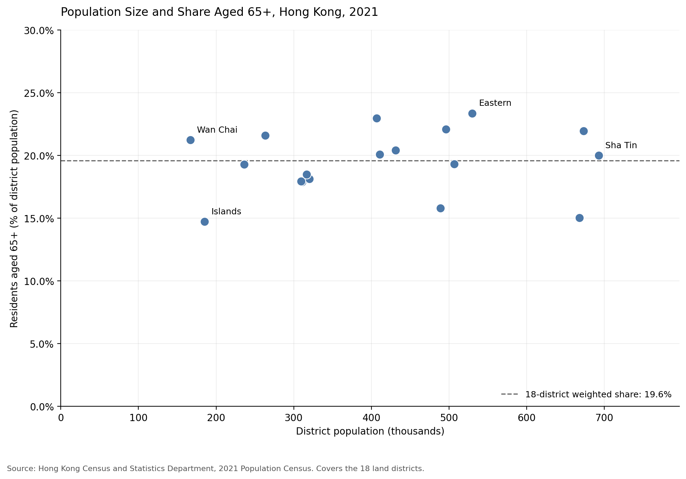

## About Me

My name is GUO QIZHEN, and I am a CISC7204 student learning to use Python for data analysis and visualization.

This portfolio presents my work with public data, including data preparation, validation, visual communication, and interpretation. My current project explores population size and age structure across Hong Kong's districts.

## Technical Skills

Skills practised in this project include:

- Python and Jupyter Notebook for exploratory analysis.
- pandas for reading, filtering, and validating tabular data.
- NumPy for numerical checks.
- Matplotlib for creating and exporting visualizations.
- GitHub for organizing code, documentation, and project files.

## Featured Project

### Population Size and Age Structure Across Hong Kong's 18 Districts

**Reference year:** 2021  
**Status:** Initial exploratory analysis completed.

### Research Questions

1. How does age structure differ across Hong Kong's 18 districts?
2. Do more populous districts also have higher proportions of residents aged 65 and over?

### Data and Methods

The project uses the Hong Kong Census and Statistics Department's 2021 Population Census data.

The analysis covers the 18 land districts and excludes Marine residents. It checks district records and population totals, calculates age-group percentages, and compares population size with the proportion aged 65 and over.

### Visualization 1: District Age Structure

The chart compares the shares of residents aged 0–14, 15–64, and 65 and over.

Eastern had the highest proportion aged 65 and over, approximately **23.4%**, while Islands had the lowest, approximately **14.7%**.

### Visualization 2: Population Size and Older-Population Share

Each point represents one district. The dashed line shows the population-weighted share aged 65 and over across the 18 districts, approximately **19.58%**.

Across Hong Kong's 18 land districts in 2021, this descriptive comparison showed **no clear linear relationship** between population size and the proportion aged 65 and over (Pearson r = **0.130**). Population size alone provided little indication of a district's older-population share. This does not establish that the variables are unrelated.

### Limitations

- The data describe 2021, not Hong Kong's current population structure.
- District-level summaries hide differences within districts and cannot describe individual residents.
- This descriptive analysis does not establish causation or explain changes over time.

### Explore the Full Project

[View the project repository, notebook, and reproduction instructions](https://github.com/Re-Kwok-12/data-science-project)

### Next Steps

I would like to compare compatible census years and investigate smaller geographical areas, while checking changes in geographical boundaries.

## Data Source and Acknowledgement

Source: Census and Statistics Department, Hong Kong SAR Government, 2021 Population Census — Statistics by District Council District.

[Official dataset page](https://data.gov.hk/en-data/dataset/hk-censtatd-census_geo-2021-population-census-by-dcd)

[DATA.GOV.HK Terms and Conditions](https://data.gov.hk/en/terms-and-conditions)

Acknowledgement: Census and Statistics Department, Hong Kong SAR Government, and DATA.GOV.HK. Intellectual property rights in the source data remain with the Government and any relevant rights holders.

The analysis and figures are student work and are not official government statistical products.
